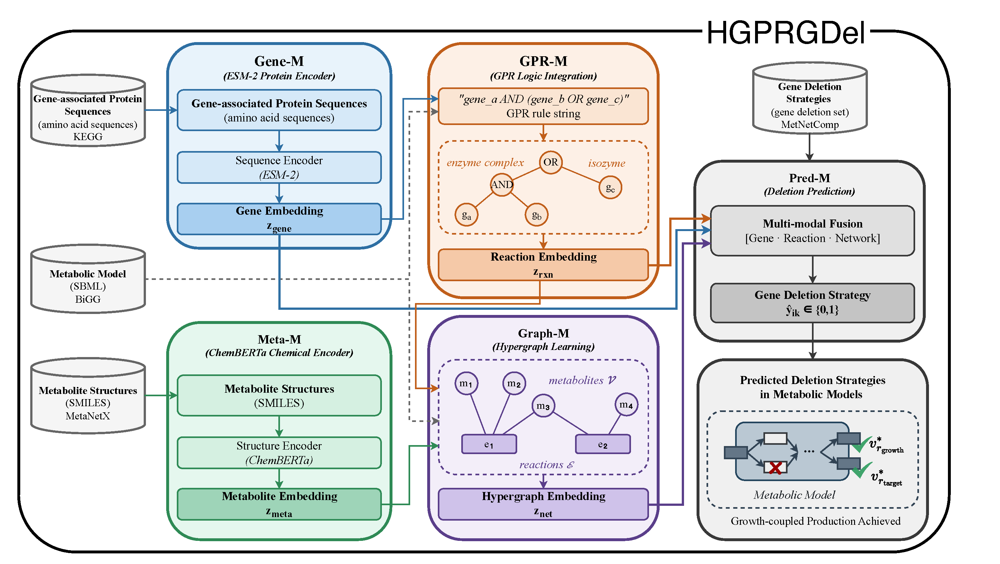

# HGPRGDel

**HGPRGDel: GPR-Aware Learning and Ranking for Growth-Coupled Gene Deletion Design**

[](LICENSE.txt)
[](requirements.txt)

Learn gene–target deletion priorities for growth-coupled strain design in genome-scale metabolic models (GEMs) using differentiable GPR logic, a reaction-centric metabolic hypergraph, and molecular representations. This repository provides the implementation, data, pretrained weights, and evaluation code for HGPRGDel.

---

## Overview

Growth-coupled gene deletion is a strain-design strategy in metabolic engineering in which genetic interventions couple target production to cellular growth. Identifying such interventions requires searching a combinatorial space of gene-deletion combinations under constraint-based metabolic models. HGPRGDel learns from previously obtained computational deletion strategies from [MetNetComp](https://www.genome.jp/metnetcomp/database1/indexFiles/index.html) and produces continuous gene–target deletion priorities that can be used to order the intervention space for downstream constraint-based search and assessment.

<p align="center">
  
</p>

<p align="center">
  <em>HGPRGDel learning component (Gene-M · Meta-M · GPR-M · Graph-M · Pred-M).</em>
</p>

- **GPR-aware learning**: COBRA-style AND/OR rules are represented through differentiable soft aggregation, capturing enzyme-complex and isozyme relationships.
- **Reaction-centric hypergraph**: reactions are represented as hyperedges over participating metabolites, with GPR-derived attributes incorporated into message passing.
- **Molecular representations**: frozen ESM-2 and ChemBERTa backbones provide protein and metabolite representations.
- **Deletion prioritization**: the model produces continuous retention scores that are converted into gene–target deletion priorities and used to construct ordered candidate intervention spaces.
- **Downstream assessment**: candidate deletion sets are evaluated independently using constraint-based metabolic analysis; the learned ranking does not itself determine growth-coupling feasibility.
- **Ready to run**: three GEMs and checkpoints are included in the repository; the *e_coli_core* quick-run takes a few minutes.

| Module | Code | Role |
|--------|------|------|
| **Gene-M** | [`model/gene_module.py`](model/gene_module.py) | ESM-2 → gene embeddings |
| **Meta-M** | [`model/metabolite_module.py`](model/metabolite_module.py) | ChemBERTa → metabolite embeddings |
| **GPR-M** | [`model/gpr_module.py`](model/gpr_module.py) | Soft AND/OR → reaction embeddings |
| **Graph-M** | [`model/hypergraph_module.py`](model/hypergraph_module.py) | Hypergraph MP with GPR hyperedge attrs |
| **Pred-M** | [`model/hgprgdel_model.py`](model/hgprgdel_model.py) | Integrates gene, metabolite, and reaction context → retention score |

---

## Quick start

```bash
# Prefer Installation below if you need CUDA + torch-geometric
pip install -r requirements.txt

cd Data && unzip -o e_coli_core.zip && cd ..

python quickrun/verify_data_layout.py --quick-start-only
python quickrun/verify_release_checkpoints.py
python quickrun/quick_run_HGPRGDel.py --CBM e_coli_core
```

**Output:** `runs/quick_run/e_coli_core/predictions/all_metabolites_predictions.csv`

| Column | Meaning |
|--------|---------|
| `Prediction` | Retention score in \([0,1]\); lower values correspond to higher deletion priority |
| `Binary_Prediction` | Thresholded reference-label prediction (`0` = deletion-associated, `1` = retention-associated) |
| `True_Label` | Reference label when available (`-1` if missing) |

First run downloads ESM-2 / ChemBERTa from Hugging Face (cached afterward). Larger GEMs: unzip `iMM904.zip` / `iML1515.zip` and pass `--CBM` accordingly — see [`Data/README.md`](Data/README.md), [`checkpoints/README.md`](checkpoints/README.md).

### Baselines (optional)

```bash
python quickrun/quick_run_baseline_GraphGdel.py
python quickrun/quick_run_baseline_DNN.py
python quickrun/quick_run_baseline_DeepGDel.py
python quickrun/quick_run_baseline_NMA.py
```

Weights: [`baseline/`](baseline/) · notes: [`quickrun/README.md`](quickrun/README.md).

---

## Installation

- **Python 3.11+** recommended.
- Install **PyTorch first**, matching your CUDA/CPU build — `torch-geometric` extension wheels must use the **same** Torch/CUDA combo, or imports fail with cryptic symbol errors. Follow the [PyG install matrix](https://pytorch-geometric.readthedocs.io/en/stable/install/installation.html). Example aligned with `requirements.txt` (Torch 2.11 + CUDA 12.6):

```bash
pip install torch==2.11.0 --index-url https://download.pytorch.org/whl/cu126
pip install torch-geometric==2.7.0
pip install pyg_lib torch_scatter torch_sparse -f https://data.pyg.org/whl/torch-2.11.0+cu126.html
pip install -r requirements.txt   # skips torch if 2.11.0 is already satisfied
```

For CPU-only: use the `cpu` Torch wheel index and `torch-2.11.0+cpu` in the PyG `-f` URL.
- **Core inference** (HGPRGDel quick-run): PyTorch, torch-geometric, transformers, pandas, scikit-learn, pyyaml, tqdm.
- **Baselines** also need TensorFlow (pinned in `requirements.txt`). Skip that stack if you only run HGPRGDel.
- GPU optional; *e_coli_core* is fine on CPU.

---

## Training & evaluation

Metabolite-held-out five-fold CV with fold-specific graph masking (seed 42): [`utils/cv_partitions.json`](utils/cv_partitions.json).

```bash
python HGPRGDel_main.py --CBM e_coli_core
```

Configs: [`trainer/configs/`](trainer/configs/). Prediction threshold defaults to train-set macro-F1 tuning. For downstream use, continuous retention scores are converted to deletion priorities rather than treated as final growth-coupling predictions.

---

## Layout

```
HGPRGDel_main.py     train / CV / inference
quickrun/            verify + quick_run (HGPRGDel & baselines)
model/               Gene-M · Meta-M · GPR-M · Graph-M · Pred-M
utils/               data, CV, metrics
trainer/             training loops & configs
Data/                *.zip → unpack once
checkpoints/         model_<GEM>.sav
baseline/            baseline code & e_coli_core weights
assets/              overview figure
```

---

## License

Source code in this repository is released under the [MIT License](LICENSE.txt).
